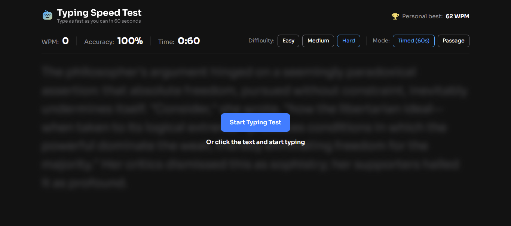
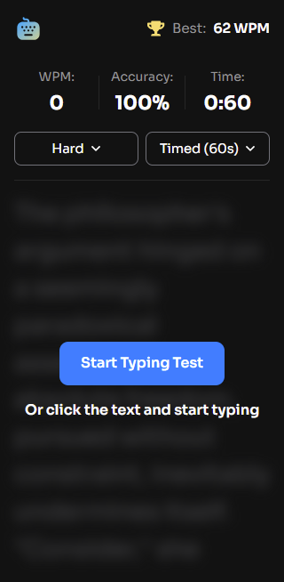

# Frontend Mentor - Typing Speed Test solution

This is a solution to the [Typing Speed Test challenge on Frontend Mentor](https://www.frontendmentor.io/challenges/typing-speed-test). Frontend Mentor challenges help you improve your coding skills by building realistic projects.

## Table of contents

- [Overview](#overview)
  - [The challenge](#the-challenge)
  - [Author](#author)
  - [Screenshot](#screenshot)
  - [Links](#links)
- [My process](#my-process)
  - [Built with](#built-with)
  - [What I learned](#what-i-learned)
  - [Continued development](#continued-development)
  - [Useful resources](#useful-resources)
  - [AI Collaboration](#ai-collaboration)
- [Acknowledgments](#acknowledgments)

## Overview

## Author


- Frontend Mentor - [Waqas Siddique](https://www.frontendmentor.io/profile/battleshopventureswaqas-blip)


### The challenge

Users should be able to:

- View the optimal layout for the interface depending on their device's screen size (Desktop `1440px` and Mobile `375px`)
- See hover and focus states for all interactive elements on the page
- Select between three difficulty levels (**Easy**, **Medium**, **Hard**) with passages loaded from `data.json`
- Switch between **Timed (60s)** countdown mode and **Passage** stopwatch mode
- Start the typing test either by clicking the **Start Typing Test** button or clicking directly on the blurred passage and typing
- Track real-time **WPM (Words Per Minute)**, **Accuracy (%)**, and **Time** while typing
- See live character-by-character visual feedback (green for correct characters, red underline for errors, and a highlighted cursor for the current character)
- Use `Backspace` to fix mistyped characters while keeping original errors counted in the accuracy calculation
- View customized result screens for their first test (**"Baseline Established!"**), standard runs (**"Test Complete!"**), and new high scores (**"High Score Smashed!"** with confetti)
- Persist their **Personal Best WPM** across browser sessions using `localStorage`

### Screenshot

#### Desktop View


#### Mobile View
<p align="left">
  
</p>

> 

### Links

- Solution URL: [GitHub Repository](https://github.com/battleshopventureswaqas-blip/Typing-Master)
- Live Site URL: [Live Demo](https://battleshopventureswaqas-blip.github.io/Typing-Master/)

## My process

### Built with

- Semantic HTML5 markup
- CSS3 custom properties (`:root` variables)
- Flexbox & responsive media queries
- Mobile-first workflow
- [Bootstrap 5](https://getbootstrap.com/) - Responsive layout and utility classes
- JavaScript (ES6+)
- [jQuery](https://jquery.com/) - DOM manipulation and event handling
- [Google Fonts - Sora](https://fonts.google.com/specimen/Sora) - Typography (weights 400, 600, 700)
- Web Storage API (`localStorage`) - Persistent Personal Best WPM tracking

### What I learned

Building this project helped me strengthen my understanding of real-time keyboard event handling, DOM performance with `DocumentFragment`, and cross-device input synchronization between physical desktop keyboards and mobile virtual keyboards.

1. **Rendering Characters Efficiently as Individual `<span>` Elements:**
   To highlight each character in green or red and move the active cursor smoothly, the passage string is split into individual `<span class="char">` elements inside a `DocumentFragment`:

```html
<!-- Passage Container with Hidden Input for Mobile Keyboard Support -->
<section class="passage-section position-relative">
  <input
    type="text"
    id="hiddenTypingInput"
    class="hidden-typing-input"
    autocomplete="off"
    autocorrect="off"
    autocapitalize="off"
    spellcheck="false"
    aria-label="Typing input"
  />
  <div id="passageContainer" class="passage-text blurred" tabindex="0"></div>
</section>
```

### Continued development

In future iterations of this project, I plan to focus on:

Adding optional mechanical keyboard sound effects and error audio feedback using the Web Audio API.

Creating a historical WPM chart using Chart.js so users can visualize their typing speed and accuracy progression over multiple sessions.

Adding custom timer durations (15s, 30s, 60s, 120s) alongside the default 60-second mode.

### Useful resources

MDN Web Docs - KeyboardEvent - Helped me handle physical keyboard events, modifier keys, and preventDefault() behavior cleanly.

Bootstrap 5 Documentation - Useful reference for responsive flex utilities and breakpoint classes.

MDN Web Docs - Window.localStorage - Used for storing and retrieving the user's Personal Best WPM score across sessions.

### AI Collaboration

Tools Used: Gemini AI Assistant

How It Was Used:

Assisted in structuring the responsive layout to match the desktop (1440px) and mobile (375px) designs accurately.

Helped debug file:// protocol CORS restrictions when loading data.json locally by embedding fallback passage data alongside fetch().

Helped resolve duplicate character input caused by overlapping keydown and input listeners when using a hidden input field for mobile keyboards.

What Worked Well: Breaking down UI states (Not Started, Active Test, First Test Baseline, Standard Result, and New Personal Best) and testing edge cases iteratively made development much faster.


## Acknowledgments

Thanks to Frontend Mentor for providing the design specifications, style guide, and assets for this challenge.

<FollowUp>
<item>How do I enable GitHub Pages so my Live Site URL works?</item>
<item>Where should I place the desktop and mobile screenshot images in my folder so they show up on GitHub?</item>
<item>How do I submit this completed solution on the Frontend Mentor website?</item>
</FollowUp>


